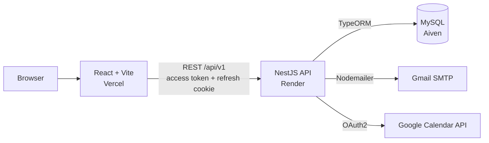
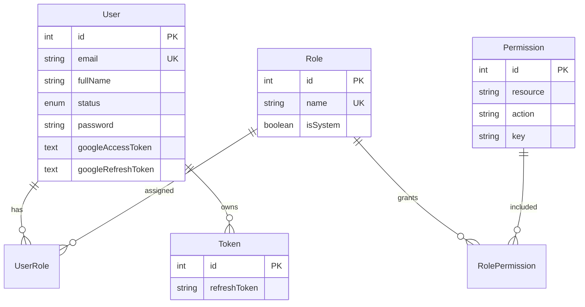
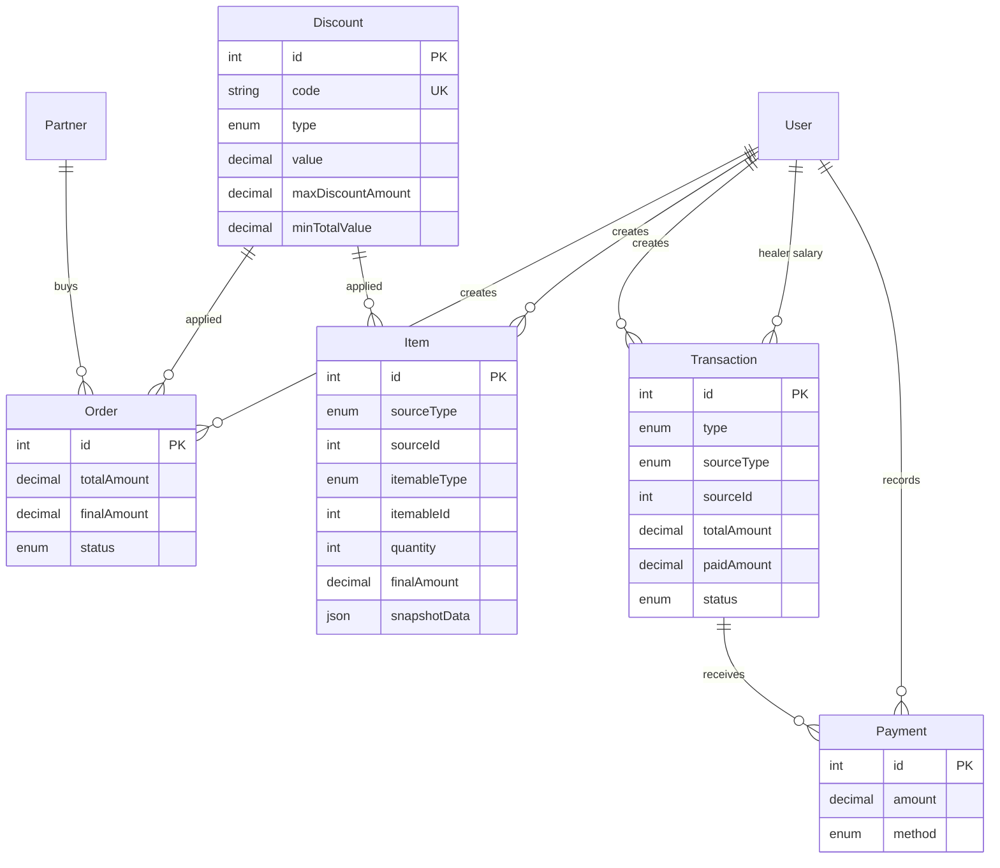
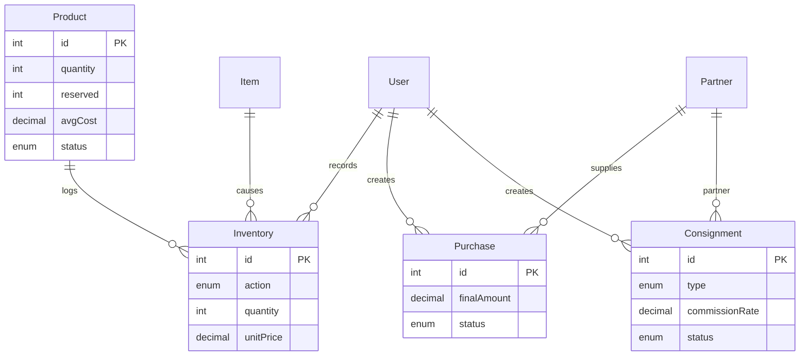
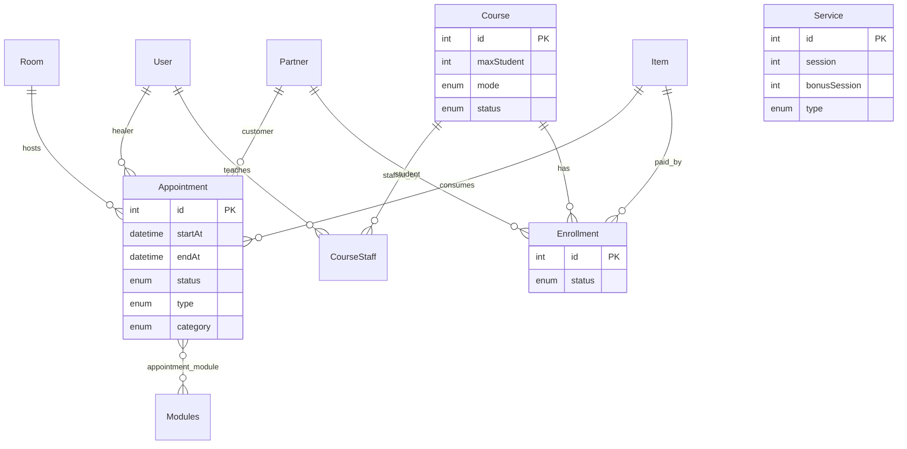
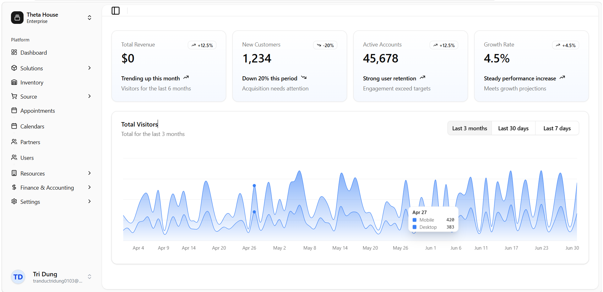
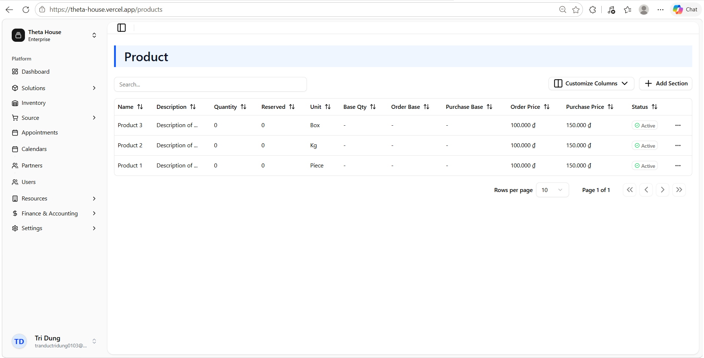

# ThetaHouse

A full-stack internal management system for a small service-and-retail business. It covers sales orders, purchasing, consignment, inventory, therapy appointments, courses and enrollments, and financial tracking, with a focus on **business-rule correctness and data integrity** (partial payments, multi-table DB transactions, an append-only payment ledger) and **dynamic role-based access control**.

> In active development

**Live demo**

- Frontend: https://theta-house.vercel.app
- API: https://thetahouse-backend.onrender.com/api/v1
- Swagger (production): https://thetahouse-backend.onrender.com/docs

> The API sleeps when idle, so the first request can take 30-60 seconds.

**Demo account**

| Email                   | Password   |
| ----------------------- | ---------- |
| `demoaccount@gmail.com` | `password` |

## Table of Contents

- [Features](#features)
- [Tech Stack](#tech-stack)
- [Architecture Highlights](#architecture-highlights)
- [Database Design](#database-design)
- [Getting Started](#getting-started)
- [Environment Variables](#environment-variables)
- [Available Scripts](#available-scripts)
- [API Documentation](#api-documentation)
- [Screenshots](#screenshots)
- [Project Structure](#project-structure)
- [Deployment](#deployment)
- [Roadmap](#roadmap)

## Features

### Business modules (17)

| Area       | Modules                                     | What they do                                                                                 |
| ---------- | ------------------------------------------- | -------------------------------------------------------------------------------------------- |
| Sales      | `order`, `item`, `discount`                 | Orders made of polymorphic line items, discounts at order and item level                     |
| Money      | `transaction`, `payment`                    | Income/expense records with multiple partial payments each                                   |
| Purchasing | `purchase`, `consignment`                   | Supplier purchases, consignment in/out                                                       |
| Inventory  | `product`, `inventory`                      | Stock quantity, reserved stock, movement log, weighted average cost                          |
| Services   | `service`, `appointment`, `room`, `modules` | Service packages with main/bonus sessions, appointments with room and healer conflict checks |
| Education  | `course`, `enrollment`                      | Courses with staff, capacity-limited enrollment                                              |
| People     | `user`, `partner`                           | Internal users, customers and suppliers                                                      |

### Technical features

- **Dynamic RBAC**: roles, permissions and their mappings live in the database, and endpoints are protected by `resource:action` permission keys.
- **JWT authentication**: short-lived access token, refresh token in an HttpOnly cookie, email verification and password reset via Nodemailer.
- **Partial payments**: each transaction accepts many payments, and the paid amount and status are updated atomically.
- **DB transactions**: multi-table operations run inside TypeORM transactions (25 transaction blocks across order, purchase, consignment, payment, transaction, inventory, appointment and role assignment services).
- **Append-only payments**: payments cannot be edited or deleted, and cancelling an order or purchase creates a compensating expense transaction instead of rewriting history.
- **Status-based soft delete with restore** for catalog entities (products, services, courses, discounts, modules).
- **Google Calendar (OAuth2, per user)**: creates a calendar event on the healer's calendar when an appointment is created, and tokens are encrypted at rest.
- **Request validation**: global `ValidationPipe` with `whitelist`, `forbidNonWhitelisted` and `transform`, backed by DTOs.
- **Dashboard and reports**: period-based income/expense/profit summary, daily income/expense chart, order/purchase/consignment counts, stock summaries and an estimated gross profit report.
- **Swagger** API documentation at `/docs`.

## Tech Stack

| Layer          | Technology                                     |
| -------------- | ---------------------------------------------- |
| Backend        | NestJS, TypeScript, TypeORM, MySQL             |
| Auth           | JWT, bcrypt, Nodemailer (Gmail)                |
| Integrations   | Google Calendar API (`googleapis`, OAuth2)     |
| Frontend       | React, Vite, TailwindCSS                       |
| Infrastructure | Render (API), Vercel (frontend), Aiven (MySQL) |

## Architecture Highlights

### System overview



### Dynamic RBAC

Permissions are rows in the database, not hard-coded decorators on roles.

| Table               | Purpose                                                                                |
| ------------------- | -------------------------------------------------------------------------------------- |
| `permission`        | One row per `resource` + `action` (unique pair) with a `key` such as `resource:action` |
| `role`              | Role name (normalized to lowercase) and an `isSystem` flag                             |
| `roles_permissions` | Role to permission mapping                                                             |
| `users_roles`       | User to role mapping                                                                   |

- Controllers declare required permissions with `@RequirePermissions(...)`, and `PermissionsGuard` resolves the user's permissions from the database through `AuthorizationService.checkPermissions`. Permissions are not cached, so changes apply immediately.
- `superadmin` bypasses permission checks. Seeded roles are `superadmin` and `admin`. `admin` does not receive permissions on the `authorization` resource, so only a superadmin can manage roles.
- The schema supports many roles per user (permissions would be the union), but the current role-assignment endpoint replaces the user's existing role.
- The first account registered on an empty database becomes an active `superadmin`. Later accounts start as `Unverified`.
- Login is only allowed for `Active` accounts (`Unverified`, `Pending` and `Inactive` are rejected).

### Authentication

1. Sign up: password hashed with bcrypt. Outside the first account, the user receives a verification email in production.
2. Login: the access token is returned in the response body and the refresh token is set as an HttpOnly cookie.
3. Refresh tokens are stored **as bcrypt hashes** in the `token` table, never as raw JWTs. A user can hold at most `MAX_TOKEN` sessions (default 5).
4. Password reset: a signed reset link is emailed to `Active` accounts.

### Payment model

A **transaction** is an income or expense record, and **payments** are the individual installments paid against it.

| Concept          | Details                                                                                                     |
| ---------------- | ----------------------------------------------------------------------------------------------------------- |
| Transaction type | `Income`, `Expense`                                                                                         |
| Source           | Polymorphic `sourceType` + `sourceId` (`Order`, `Purchase`, `Consignment`), or no source for manual entries |
| Payer            | `payerType` + `payerId` (`User` or `Partner`)                                                               |
| Status           | `Unpaid`, `Partial`, `Paid`, `Overpaid`, derived from `paidAmount` vs `totalAmount`                         |
| Payment methods  | `Momo`, `Cash`, `Bank Transfer`, `Visa` (recorded only, no payment gateway)                                 |

How it works:

1. Creating an order creates an `Income` transaction for the customer, and creating a purchase creates an `Expense` transaction for the user who made it. Consignment-in creates an expense and consignment-out an income.
2. Adding a payment runs in a DB transaction: load the transaction, reject it if already settled or its source is cancelled, compute the balance as `totalAmount - paidAmount`, **reject any amount greater than the balance**, add to `paidAmount`, recompute the status, save the payment, commit.
3. Outstanding debt is `totalAmount - paidAmount`.
4. Payments are never updated or deleted. Cancelling an order or purchase creates an `Expense` transaction (no source) for the amount already paid, so past payments stay untouched.
5. Healer salary transactions can be generated from completed appointments.

### Orders, items and pricing

- An `item` is a line item that points to its parent with `sourceType`/`sourceId` (`Order`, `Purchase`, `Consignment`) and to what is sold with `itemableType`/`itemableId` (`Product`, `Service`, `Course`). This lets one item table serve sales, purchases and consignment.
- `totalAmount = unitPrice * quantity`, and `finalAmount` is the amount after discount.
- Discounts (`Percentage` or `Fixed`) apply at item and order level. The discount is capped by `maxDiscountAmount`, never goes below zero and only applies when `minTotalValue` is met. Example: 2 x 100,000 with a 10% discount capped at 15,000 gives a final amount of 185,000.
- Service items store a `snapshotData` of the service's duration and sessions at the time of sale, so later edits to the service do not change existing orders.
- Items can be added, removed or changed after the order is created, and order and transaction amounts are recalculated in the same DB transaction.
- Cancelling an order creates the compensating transaction, releases unexported stock, cancels appointments, withdraws enrollments and deactivates its items.

### Inventory

- `product.quantity` and `product.reserved` track stock, and every movement is written to the `inventory` table as `Import`, `Export`, `Adjust-Plus` or `Adjust-Minus`.
- Creating an order reserves stock. Exporting inventory consumes the reserved amount and is rejected if it exceeds what was reserved. Cancelling releases stock that was not yet exported.
- On import, `avgCost` is recalculated as a weighted average of existing stock and the incoming unit price.

### Appointments and services

- A service is sold with `session` main sessions and `bonusSession` bonus sessions per unit.
- Appointment creation checks **healer availability** and **room availability** for the requested time range, and rejects overbooking of main sessions (capped at `session x quantity`).
- Bonus sessions are only unlocked after the corresponding main sessions are completed, and a free session can be used once per customer.
- An appointment is `Confirmed` when it has all required information and `Pending` otherwise. Statuses: `Pending`, `Confirmed`, `Completed`, `Cancelled`.

### Courses and enrollment

- A course has online/offline sessions, a mode (`Online`, `Offline`, `Combine`), a `maxStudent` limit and staff with the roles `Coach` or `Trainer`.
- Enrollment checks the number of remaining slots (`maxStudent` minus used slots). Statuses: `Pending`, `Enrolled`, `Withdrawn`.

### Google Calendar integration

- **OAuth2 authorization-code flow per user** (not a shared service account), requesting offline access so a refresh token is issued.
- The `state` parameter is a signed, expiring JWT (`GOOGLE_STATE_SECRET`) that is verified on callback.
- Access and refresh tokens are **encrypted with AES-256-CBC** before being stored on the user record, and are never selected by default.
- When a therapy or consultation appointment is created with a start and end time, an event is created on the **healer's** calendar. The API response includes a `calendar.status` of `success`, `failed` or `not_connected`, and a calendar failure never prevents the appointment from being saved.
- A user's Google token can be revoked through Google's revoke endpoint.

### Data integrity

- Money columns use `decimal` with explicit precision and scale (mostly `decimal(12,2)`) and a numeric transformer, so no floats are stored.
- Foreign keys use `onDelete: RESTRICT` for business records, so referenced data cannot be removed.
- Catalog entities use status-based soft delete (`Deleted`), list queries exclude deleted rows, and records can be restored.

## Database Design

Table names follow TypeORM defaults (singular, e.g. `order`, `transaction`) except `users_roles`, `roles_permissions` and `appointment_module`. `Item` and `Transaction` reference their parent through `sourceType`/`sourceId` (polymorphic), so those links are not database foreign keys and are not drawn below.

### Auth and authorization



### Sales and payments



### Inventory and purchasing



### Appointments and courses



`Service` is referenced from `Item` through `itemableType`/`itemableId` (polymorphic), and its session counts are snapshotted into `Item.snapshotData`.

## Getting Started

### Prerequisites

- Node.js 18+
- A running **MySQL** server with an empty database created for the project
- (Optional) a Google Cloud OAuth client if you want Google Calendar
- (Optional) a Gmail account with an app password for emails

### Backend

Run in `backend/`:

```bash
npm install
cp .env.example .env
npm run start:dev
```

Then stop the server, seed roles and permissions, and start it again:

```bash
npm run seed
npm run start:dev
```

The API is served at `http://localhost:3000/api/v1` and Swagger at `http://localhost:3000/docs`.

> **Important:** the first account you register on an empty database becomes the `superadmin`. Register your own account first.

### Frontend

Run in `frontend/`:

```bash
npm install
cp .env.example .env
npm run dev
```

The app is served at `http://localhost:5173`.

## Environment Variables

### Backend (`backend/.env`)

| Variable                       | Description                                                                                                                         |     |
| ------------------------------ | ----------------------------------------------------------------------------------------------------------------------------------- | --- |
| `PORT`                         | Port the API listens on                                                                                                             |
| `DB`                           | MySQL database name (must already exist)                                                                                            |
| `DB_HOST`                      | MySQL host                                                                                                                          |
| `DB_PORT`                      | MySQL port                                                                                                                          |
| `DB_USERNAME`                  | MySQL user                                                                                                                          |
| `DB_PASSWORD`                  | MySQL password                                                                                                                      |
| `ACCESS_TOKEN`                 | Secret used to sign access JWTs                                                                                                     |
| `ACCESS_TOKEN_EXPIRES`         | Access token lifetime as a duration string (e.g. `15m`)                                                                             |
| `REFRESH_TOKEN`                | Secret used to sign refresh JWTs                                                                                                    |
| `REFRESH_TOKEN_EXPIRES`        | Refresh token lifetime as a duration string (e.g. `7d`)                                                                             |
| `VERIFY_EMAIL_TOKEN`           | Secret for email-verification tokens                                                                                                |
| `VERIFY_EMAIL_TOKEN_EXPIRES`   | Email-verification token lifetime as a duration string (e.g. `15m`)                                                                 |
| `RESET_PASSWORD_TOKEN`         | Secret for password-reset tokens                                                                                                    |
| `RESET_PASSWORD_TOKEN_EXPIRES` | Reset token lifetime as a duration string (e.g. `15m`)                                                                              |
| `EMAIL_USER`                   | Gmail address used by Nodemailer                                                                                                    |
| `EMAIL_PASSWORD`               | Gmail app password                                                                                                                  |
| `GOOGLE_CLIENT_ID`             | Google OAuth2 client ID                                                                                                             |
| `GOOGLE_CLIENT_SECRET`         | Google OAuth2 client secret                                                                                                         |
| `GOOGLE_REDIRECT_URI`          | OAuth redirect URI registered in Google Cloud Console, must point to the backend's Google Calendar callback endpoint                |
| `GOOGLE_SCOPES`                | Requested scopes, **separated by spaces**                                                                                           |
| `GOOGLE_STATE_SECRET`          | Secret used to sign the OAuth `state` JWT                                                                                           |
| `GOOGLE_STATE_SECRET_EXPIRES`  | Lifetime of the `state` JWT as a duration string                                                                                    |
| `ENCRYPTION_SECRET_KEY`        | Key used to encrypt Google tokens with AES-256-CBC. Always set it explicitly                                                        |
| `SALT`                         | bcrypt salt rounds used by password reset/change (defaults to 10)                                                                   |
| `MAX_AGE`                      | Lifetime of the refresh token cookie, in days (default `7`). The application converts it to milliseconds for the cookie's `maxAge`. |     |
| `MAX_TOKEN`                    | Maximum concurrent refresh-token sessions per user (default 5)                                                                      |
| `BACKEND_URL`                  | Public URL of the API                                                                                                               |
| `FRONTEND_URL`                 | Public URL of the frontend (CORS, email links)                                                                                      |
| `ENVIRONMENT`                  | Runtime mode, set to `prod` in production to enable email verification                                                              |

### Frontend (`frontend/.env`)

| Variable           | Description                                  |
| ------------------ | -------------------------------------------- |
| `VITE_BACKEND_URL` | Base URL of the API, **including** `/api/v1` |

## Available Scripts

### Backend (run in `backend/`)

| Script                | Description                                 |
| --------------------- | ------------------------------------------- |
| `npm run start:dev`   | Start in watch mode (development)           |
| `npm run start:debug` | Start in debug and watch mode               |
| `npm run build`       | Compile to `dist/`                          |
| `npm run start:prod`  | Run the compiled build (`node dist/main`)   |
| `npm run start`       | Run via the Nest CLI with a 1 GB heap limit |
| `npm run seed`        | Seed roles and permissions                  |
| `npm run lint`        | Run ESLint (with `--fix`)                   |
| `npm run format`      | Format code with Prettier                   |

### Frontend (run in `frontend/`)

| Script            | Description                         |
| ----------------- | ----------------------------------- |
| `npm run dev`     | Start the Vite dev server           |
| `npm run build`   | Type-check and build for production |
| `npm run preview` | Preview the production build        |
| `npm run lint`    | Run ESLint                          |

## API Documentation

Interactive Swagger UI is available at `/docs`:

- Production: https://thetahouse-backend.onrender.com/docs
- Local: http://localhost:3000/docs

All endpoints are prefixed with `/api/v1`. Dashboard and report endpoints include `dashboard/summary`, `dashboard/source-summary`, `dashboard/product-summary`, `dashboard/inventory-summary`, `dashboard/trends`, `revenue`, `revenue/chart` and `report/pnl`.

## Screenshots



_Dashboard: income, expense and profit for the selected period._



_Product management._

## Project Structure

```text
ThetaHouse/
├── backend/
│   └── src/
│       ├── auth/             # signup, login, refresh, verify email, reset password
│       ├── authorization/    # roles, permissions, guard, role assignment
│       ├── token/            # hashed refresh tokens
│       ├── user/  partner/   # internal users, customers and suppliers
│       ├── order/  item/  discount/
│       ├── purchase/  consignment/
│       ├── transaction/  payment/
│       ├── product/  inventory/
│       ├── service/  appointment/  room/  modules/
│       ├── course/  enrollment/
│       ├── google-calendar/  # OAuth2 flow and event creation
│       ├── encryption/       # AES-256-CBC helper for Google tokens
│       ├── mail/             # Nodemailer
│       ├── dashboard/  revenue/  report/
│       ├── seed/             # roles and permissions seeding
│       └── common/           # enums, transformers
├── frontend/                 # React + Vite + TailwindCSS
│   └── src/
│       ├── api/
│       ├── assets/
│       ├── auth/
│       ├── components/
│       ├── hooks/
│       ├── lib/
│       ├── pages/
│       ├── types/
│       ├── App.tsx
│       ├── index.css
│       └── main.tsx
└── README.md
```

## Deployment

| Component | Platform      |
| --------- | ------------- |
| Frontend  | Vercel        |
| API       | Render        |
| Database  | Aiven (MySQL) |

For production, build and run the compiled output:

```bash
cd backend
npm run build
npm run start:prod
```

Set all backend environment variables on the host, set `FRONTEND_URL` to the Vercel URL, and set `VITE_BACKEND_URL` on Vercel to the Render URL including `/api/v1`. The Google OAuth redirect URI must also be registered in Google Cloud Console.

## Roadmap

- [ ] Automated tests for the core flows (order, payment, inventory)
- [ ] CI pipeline (lint, build, test)
- [ ] Replace TypeORM `synchronize` with migrations
- [ ] Docker Compose for local development
- [ ] Row locking on payment creation to prevent concurrent over-payment
- [ ] Store the Google event ID and update or delete events when an appointment changes
- [ ] Complete financial reports (full P&L, cash flow, balance sheet)
- [ ] Read-only role, rate limiting and security headers
